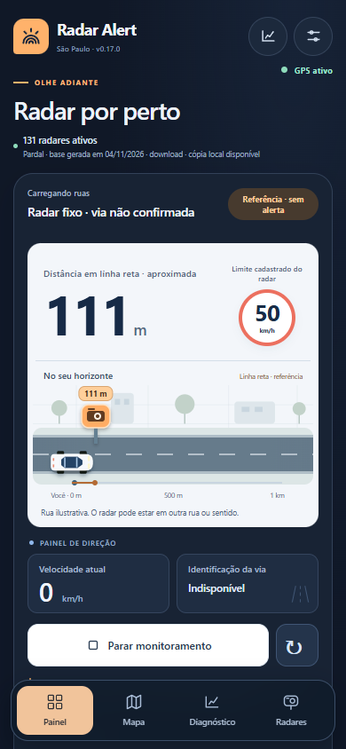

# Radar Alert 0.17.2 — Horizonte

Aplicativo Android e PWA para consultar radares de São Paulo, com distância, limite cadastrado, mapa e alertas quando a via e o sentido estão confirmados.



*Prévia com dados e GPS simulados.*

## Update log — 06/11/2026

### 0.17.2 — Validação e continuidade do GPS

- Idade e ordem das leituras nativas medidas pelo relógio monotônico Android, evitando rejeição por diferença entre o horário GPS e o celular.
- Preserva a idade real de eventos atrasados enviados ao painel.
- Renova a solicitação após 45 s sem fix válido, sem exigir reinício manual da sessão.
- Mantém START_STICKY após atualizar a base e respeita parada manual.
- Acrescenta diagnóstico de idade/diferença entre relógios, testes de recuperação e suspensão. GPS físico/tela bloqueada ainda pendentes.

### 0.17.1 — GPS parado

- Remove o filtro de deslocamento mínimo de 5 m no perfil STOPPED do serviço Android, mantendo intervalo solicitado de 6 segundos.
- Corrige uma causa de GPS desatualizado enquanto parado; a entrega das posições depende do Android e das condições de sinal.
- Preserva rumo desconhecido e referência em linha reta sem alerta quando a via/sentido não estão confirmados.
- Inclui teste de três minutos parado, perda de leituras e recuperação. Validação física com tela bloqueada continua pendente.

### 0.17.0 — Horizonte

- Nova identidade Horizonte: azul profundo, superfícies claras e detalhes em laranja.
- Distância e limite ocupam o primeiro plano, com a ilustração integrada no mesmo painel.
- Rua 2D com cenário vetorial, carro branco, radar laranja e régua proporcional à distância.
- Composição mobile mais compacta: iniciar/parar fica inteiramente visível em 390 × 844.
- Lista com placas de limite, distâncias destacadas e ícones específicos para radares.
- Alto contraste com painel escuro, estados de espera diferenciados e ajustes reorganizados.
- Ícones da PWA e do Android atualizados para a mesma identidade.
- Referências de produtos reais e materiais oficiais documentadas em [docs/REFERENCIAS-VISUAIS.md](docs/REFERENCIAS-VISUAIS.md). Não foram usados conceitos ou imagens de IA como referência.

### Correções incorporadas da versão 0.16.2

- Rejeita posições GPS antigas ou com horário inválido antes de avaliar alertas, tanto no painel quanto no serviço Android.
- Impede que consultas OSM ou eventos de uma sessão encerrada atualizem o monitoramento atual.
- Corrige a recuperação do GPS: remove erros antigos e oculta valores sem posição válida.
- Trata GPS desligado ou recusado no Android e informa quando o serviço não confirma a parada, permitindo tentar novamente.
- Corrige “Apagar dados”: cancela consultas pendentes, aguarda gravações, limpa base e mapa, restaura preferências e permite baixar novamente pelo botão Atualizar radares.
- Cancela um início Android ainda pendente antes de concluir a limpeza.
- Corrige a suspensão e o reinício da página web.
- Mantém o visual renovado e a ilustração 2D de carro, rua e radar, ligada à distância calculada.

## Distância, limite e ilustração

Com GPS válido, o painel mostra um radar ativo próximo, inclusive parado e sem OSM. Nesse caso a distância é em linha reta, o limite pertence ao cadastro do equipamento e não há alerta automático: o radar pode estar em outra rua ou sentido.

Quando a malha OSM e o sentido permitem confirmar a rota, o painel usa a distância pela via e pode emitir alertas. Sem cobertura viária válida, os alertas de rota ficam suspensos. O botão Atualizar ruas OSM permite renovar a região; indisponibilidade do servidor não impede a referência em linha reta.

A ilustração usa escala de 0 a 1 km. Acima disso o marcador fica na borda e a distância numérica continua visível. O carro permanece fixo; o radar se move conforme a distância muda. O desenho é esquemático e não representa curvas, faixas ou lado da pista. GPS recusado, antigo ou monitoramento parado ocultam o radar. A preferência de movimento reduzido é respeitada.

## Instalar no Android

Se você recebeu `RadarAlert-0.17.2-debug.apk`, abra o arquivo no Android para instalar a versão de teste: pacote `com.radalert.app`, versão 0.17.2, código 17002. A atualização sobre uma instalação anterior exige assinatura compatível. Se houver conflito, compile com a chave usada no seu projeto; desinstalar apaga dados locais e não é necessário para atualizar o código-fonte. O APK não está incluído nos arquivos deste repositório.

Inicie o monitoramento com o app aberto e permita localização precisa. O serviço Android usa uma notificação persistente. O funcionamento no celular com tela bloqueada ainda precisa de validação física nesta versão.

## Atualizar o projeto

O repositório inclui fontes, testes e templates Android. `www/` é gerada pelo build, e `android/` é criada pelo Capacitor; essas pastas não são versionadas. Preserve seu projeto Android e sua chave de assinatura.

Requisitos utilizados: Node 24.11.1 (mínimo 22.12), JDK 21 e Android SDK 36. Deixe o JDK no `PATH` e configure o SDK no Android Studio.

### Projeto existente com Git

Na pasta do projeto, confira as alterações locais antes de atualizar. Se houver trabalho local, salve-o em um commit ou stash. Depois que esta atualização estiver na `main`:

```powershell
git status
git switch main
git pull --ff-only origin main
```

Em seguida, reinstale as dependências e sincronize o Android:

```powershell
npm ci
npm test
npm run check
npm run android:sync
npm run android:verify
npm run android:open
```

No Android Studio, aguarde a sincronização e use **Run** para instalar no celular. Atualizar o código no GitHub não atualiza automaticamente o aplicativo já instalado: é necessário recompilar e instalar o novo APK.

### Primeira instalação do projeto

```powershell
git clone https://github.com/felipetaiji5-png/Radar-Alert.git
cd Radar-Alert
npm ci
npm test
npm run android:add
npm run android:verify
npm run android:open
```

Se você usa ZIP em vez de Git, extraia os arquivos na raiz onde fica `package.json`, preservando `.git/`, `android/` e sua chave. Use `npm run android:add` somente se `android/` ainda não existir; nas próximas atualizações use `npm run android:sync`.

Para compilar diretamente após sincronizar:

```powershell
cd android
.\gradlew.bat :app:assembleDebug
```

O resultado estará em `android/app/build/outputs/apk/debug/app-debug.apk`. Um APK de produção precisa ser assinado com a chave do projeto.

Para executar a versão web, use `npm run dev`; o GPS exige HTTPS ou localhost. Para publicar a PWA, sirva o conteúdo de `www/` na raiz do site com HTTPS. O navegador não garante monitoramento contínuo em segundo plano.

## Testes

Foram aprovados **200 testes Node (incluindo testes Java executáveis)**, **25 grupos de navegador**, verificação de **28 combinações de tela/largura**, build web, sincronização Android e compilação do APK. Os testes de navegador usam GPS, dados e respostas Android fictícios. Consulte [QA-REPORT.md](QA-REPORT.md) para o escopo e reprodução.

GPS físico, voz real, percurso e execução com tela bloqueada permanecem pendentes. O aplicativo não substitui a sinalização; a cobertura e a atualização das bases influenciam os resultados.

## Dados e privacidade

A base e as regiões OSM ficam armazenadas localmente. A trilha GPS do painel é volátil; não é salva como histórico de percurso. Consultas Overpass enviam uma região aproximada e o carregamento de tiles usa os servidores cartográficos. A limpeza remove os dados do aplicativo e as preferências, mas mantém os arquivos da PWA necessários para abri-la offline. Uma nova abertura online volta a consultar a base.

Consulte [ATTRIBUTION.txt](ATTRIBUTION.txt) e [ATTRIBUTION-OSM.txt](ATTRIBUTION-OSM.txt) para Pardal, OpenStreetMap e Leaflet. Alterações anteriores estão em [CHANGELOG.md](CHANGELOG.md); a documentação anterior foi preservada em `docs/`.

